# Resilient Campus Core: VLANs, LACP, Rapid PVST+, PortFast/BPDU Guard, and OSPFv2

## Project Overview
This lab builds a resilient Layer 2 and Layer 3 core in Cisco CML. It segments broadcast domains with VLANs, aggregates links with LACP, prevents loops with Rapid PVST+, protects access ports with PortFast and BPDU Guard, and runs OSPFv2 between two gateway routers. The design is then tested in two ways: a rogue switch is plugged into an access port to trigger BPDU Guard, and Port-channel 1 is shut down on the root bridge while a continuous ping measures the outage.

**Environment:** Cisco CML with 2 x IOSv routers and 3 x IOSvL2 switches.

**Demo video:** [Watch the failover test on YouTube](https://youtu.be/g_wd18Umb7g)

## Topology
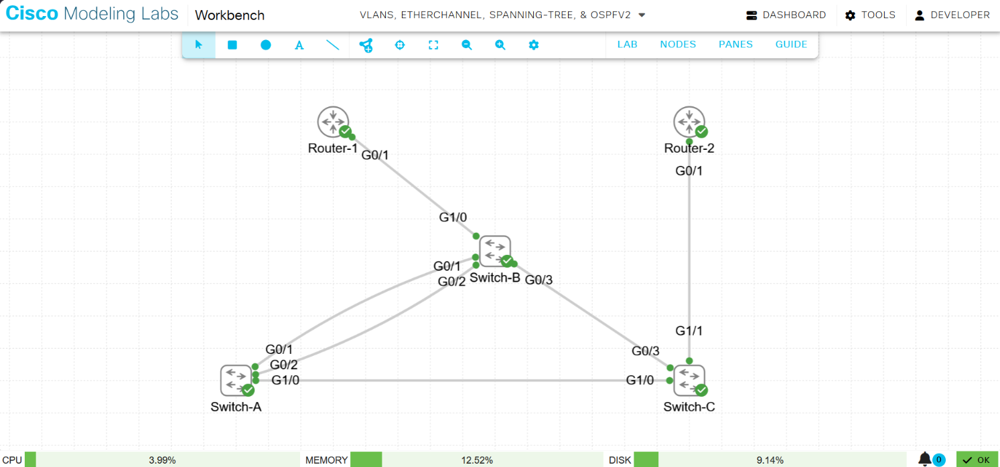

## Addressing Plan
| VLAN | Subnet | Router-1 gateway | Router-2 |
|------|--------|------------------|----------|
| 10 | 10.10.10.0/24 | 10.10.10.1 (Gi0/1.10) | 10.10.10.2 (Gi0/1.10) |
| 20 | 10.20.20.0/24 | 10.20.20.1 (Gi0/1.20) | Gi0/1.20 (see screenshot 08) |

OSPF router IDs: Router-1 `1.1.1.1`, Router-2 `2.2.2.2`.

## Technology Summary
**VLANs and 802.1Q trunking** separate department traffic into distinct broadcast domains.

**LACP EtherChannel (802.3ad)** bundles parallel links into one logical Port-channel. STP treats it as a single link, so the loss of one member does not trigger a spanning-tree recalculation.

**Rapid PVST+ (802.1w)** runs a separate spanning-tree instance per VLAN. Bridge priorities were set manually so that Switch-A is the root bridge for VLANs 1, 10, and 20.

**PortFast and BPDU Guard** were enabled as global defaults for access ports. PortFast moves access ports straight to forwarding, and BPDU Guard err-disables a port if a BPDU arrives on it, which protects the core from rogue switches.

**Router-on-a-stick** uses sub-interfaces for inter-VLAN routing over one physical link. First-hop redundancy (HSRP/VRRP) is not configured, so a gateway failure would still interrupt hosts.

**OSPFv2 (Area 0)** forms adjacencies between the two routers across VLANs 10 and 20.

## Implementation

### Phase 1: Switching core
Trunks and LACP bundles were configured across the switches.

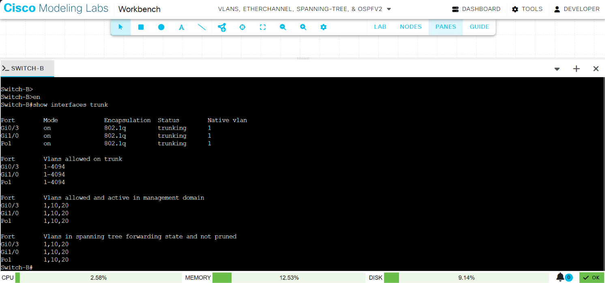

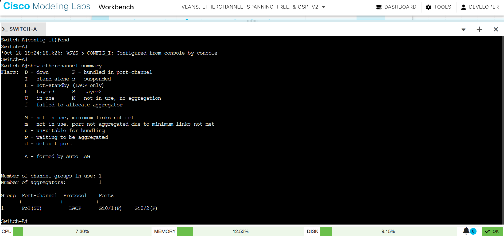

### Phase 2: Spanning tree
Switch-A was made root bridge by lowering its bridge priority.

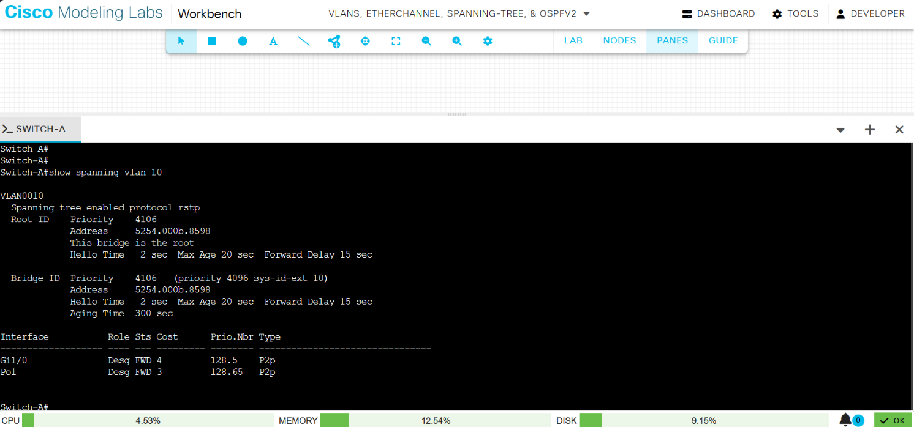

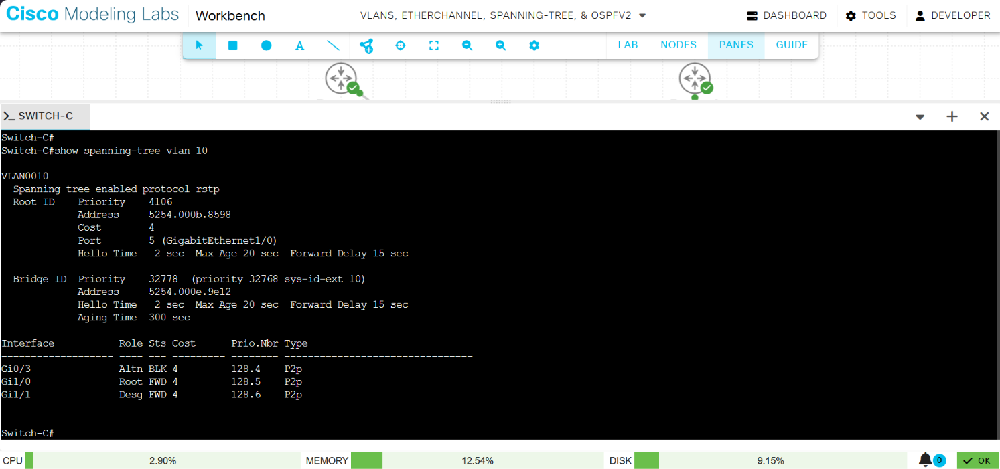

### Phase 3: Access port protection
`show spanning-tree summary` on Switch-A confirms Rapid PVST+ mode, PortFast edge default, and BPDU Guard default enabled.

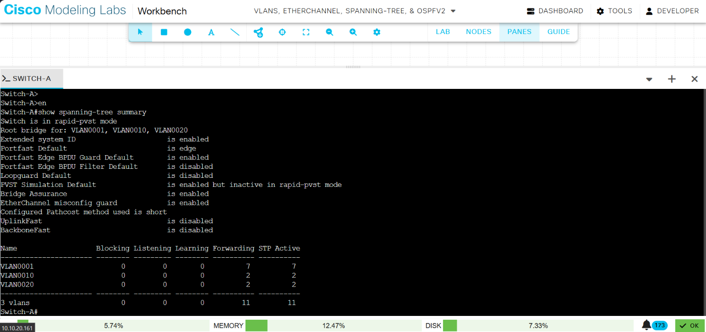

### Phase 4: Inter-VLAN routing
Router-1 and Router-2 were configured with sub-interfaces for VLANs 10 and 20, and connectivity between them was tested.

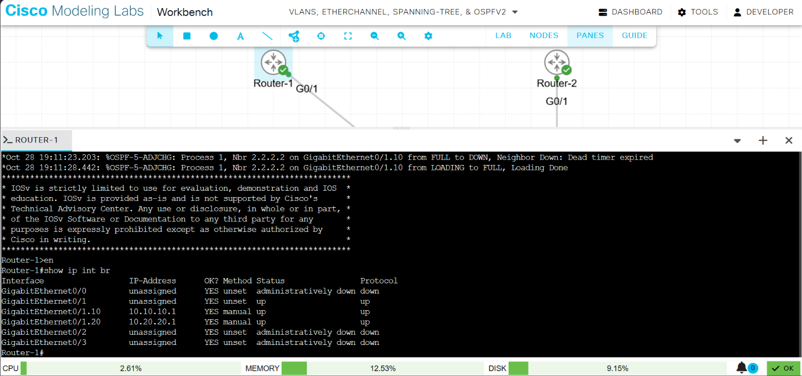

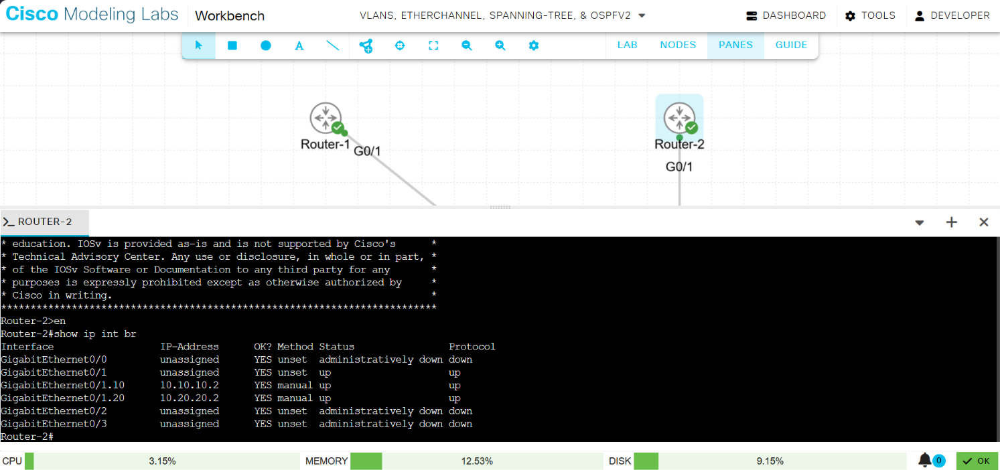

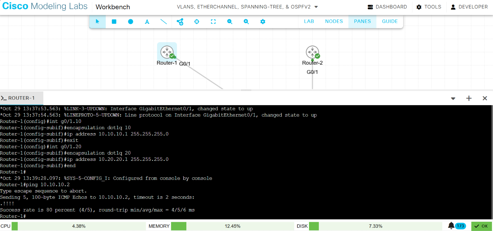

### Phase 5: OSPFv2
Both routers run OSPF in Area 0. Both routers share the VLAN subnets as directly connected networks, so OSPF has no learned routes to install; adjacency and database state were used for verification.

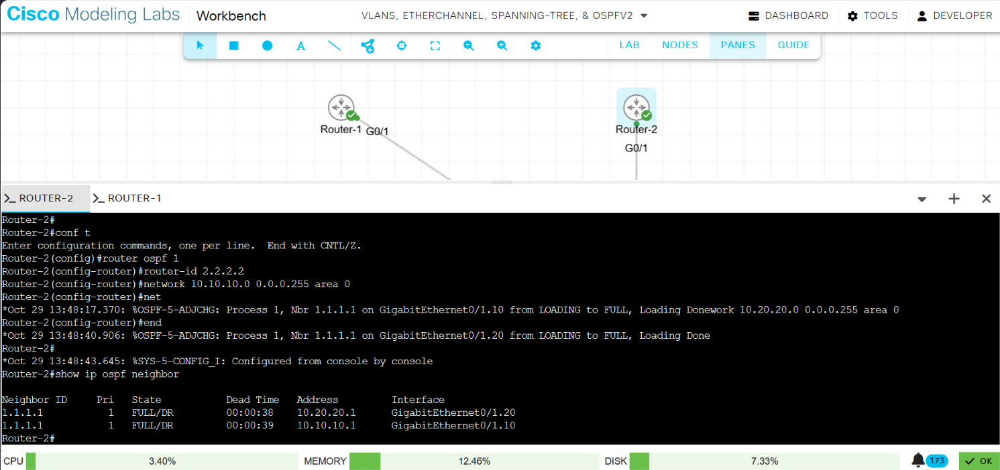

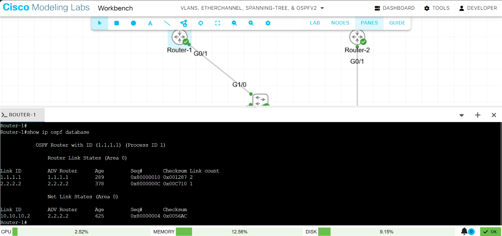

## BPDU Guard Test
To test BPDU Guard, a rogue switch (a Cisco IOL L2 node, `iol-l2-0`) was connected to Switch-A Gi0/0, an access port. Switch-A received a BPDU on that port and err-disabled it.

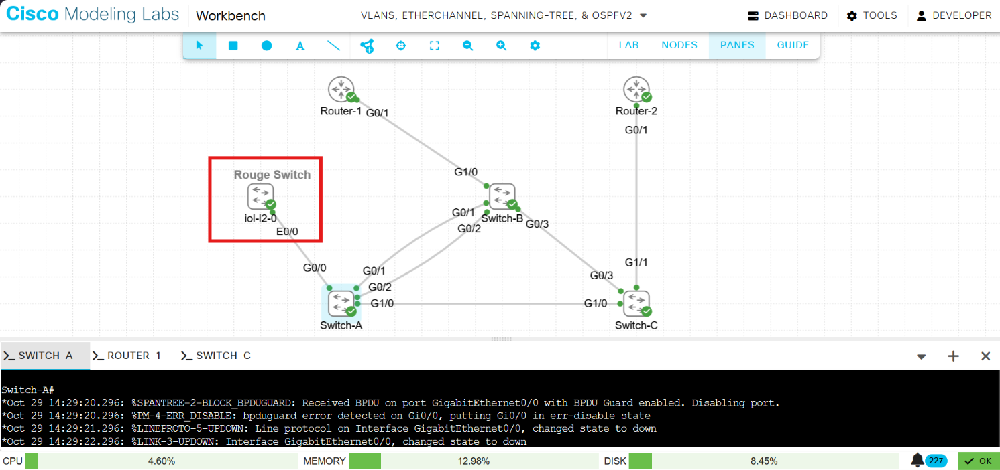

## Failover Test
Port-channel 1 on Switch-A was shut down (`interface port-channel 1`, then `shutdown`) while Router-1 ran `ping 10.10.10.2 repeat 10000 timeout 1`.

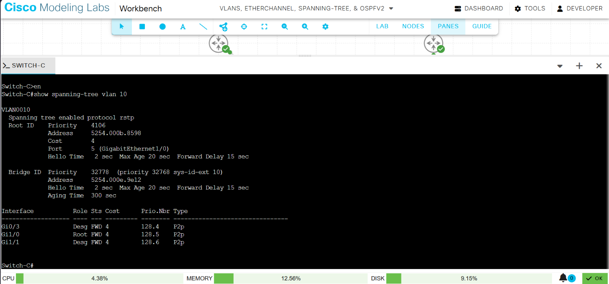

**Result:** Switch-C's Gi0/3 moved from Altn BLK to Desg FWD, restoring a path around the failed Port-channel. The ping returned 9,982 of 10,000 replies, so 18 were lost. Because each lost reply waits out the 1-second timeout, this corresponds to roughly 18 seconds without connectivity. An earlier run lost 35 replies, so convergence time varied between runs. Both results are slower than the figures commonly quoted for Rapid PVST+.

## Lessons Learned
A spanning-tree design has to do more than block loops. Link aggregation recovers bandwidth that STP would otherwise leave idle on blocked links, and PortFast with BPDU Guard keeps access ports from becoming a way for a rogue switch to alter the topology. Measuring the failover showed that convergence in this lab was much slower than the theoretical Rapid PVST+ figure, which is a reminder to verify behavior with a real test rather than assume it.

**Next step:** check whether the Switch-B and Switch-C Gi0/3 links are reported as point-to-point or shared (`show spanning-tree vlan 10`), since a shared link type makes Rapid PVST+ fall back to slower timers, and repeat the test.

## Skills Demonstrated
VLANs, 802.1Q trunking, LACP, Rapid PVST+, PortFast/BPDU Guard, router-on-a-stick, OSPFv2, failover testing and measurement
